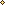

# Design-Handbuch

Dieses Projekt hat einen **Pixel-Art-Planner-Look**: Creme-Papier mit Punktraster, Karten mit dicken Pixelrahmen und Reitern und ein gestufter Pixel-Himmel. Hier steht, wie alles funktioniert und wie du es benutzt.

**Wo steht was?**

| Datei | Inhalt |
|---|---|
| `css/tokens.css` | alle Farben, Größen und Schriften. Hier änderst du das Aussehen. |
| `css/components.css` | die Bausteine (Karte, Reiter, Toggle …) |
| `css/sky.css` | der Pixel-Himmel |
| `js/toggle.js` | das Umschalten zwischen Abschnitten |
| `assets/` | Schrift, Deko-Motive, Icons |
| `tools/pixel-motive.mjs` | Werkzeug, um Motive neu zu zeichnen (siehe unten) |

---

## 1. Die Regeln des Pixel-Looks

1. **Alles sitzt auf dem Pixel-Raster.** `--px` ist 4 Bildschirmpunkte groß. Abstände, Rahmen und Icon-Größen sind immer ganze Vielfache davon, zum Beispiel `calc(3 * var(--px))`.
2. **Bilder nur ganzzahlig vergrößern:** 2-fach, 3-fach, 4-fach und so weiter, nie 1,5-fach. Sonst werden die Pixel unscharf. Breite und Höhe im HTML sind deshalb immer *Originalgröße × ganze Zahl*.
3. **Keine Rundungen** (`border-radius`). Ecken sind treppenförmig.
4. **Keine weichen Verläufe.** Farben wechseln in harten Stufen, Übergänge sind Schachbrett-Pixel.
5. **Keine Schatten und keine Unschärfe.**
6. **Farben nur aus `tokens.css`.** Neue Farben dort anlegen und von dort aus benutzen.
7. **Deko sparsam einsetzen** und immer mit `alt=""` und `aria-hidden="true"`, damit Screenreader sie überspringen.

---

## 2. Farben

### Grundfarben

| Name | Farbe | Wofür |
|---|---|---|
| `--cream` | #FFF7EC | helle Flächen, Schrift auf Dunklem |
| `--page` | #FFF4E4 | Seitenhintergrund (wird je Stimmung leicht getönt) |
| `--dot` | #E9D3B8 | Punkte im Punktraster |
| `--ink` | #3B2418 | Haupttext (Schoko) |
| `--ink-soft` | #5E4030 | Nebentext |
| `--terracotta-dark` | #A84A2A | Knöpfe |

### Kartenfarben

Jede Karte hat vier Farben: eine dünne **Außenlinie**, einen dicken **Rahmen** (auch der Reiter), eine helle **Füllung** und eine kräftigere Farbe für **gedrückte** Knöpfe.

| Klasse | Name | Rahmen | Füllung |
|---|---|---|---|
| `card--apricot` | Apricot | #E9A06E | #FDEBD8 |
| `card--sage` | Salbeigrün | #9DBB8E | #EEF4E6 |
| `card--dusk` | Dämmerblau | #A9ACDA | #EFEFFA |
| `card--mustard` | Senfgelb | #E3BC55 | #FDF4D9 |
| `card--rose` | Rosé | #E7A3B2 | #FDEFF2 |
| `card--warning` | Terrakotta (Achtung) | #E0805E | #FFF0E8 |

Der Text (Schoko) hat auf allen Rahmen- und Füllfarben mindestens **5 : 1 Kontrast**. Das erfüllt die Regel für gute Lesbarkeit (WCAG AA, mindestens 4,5 : 1).

### So änderst du eine Farbe

Öffne `css/tokens.css`, suche die Zeile, zum Beispiel `.card--sage { … }`, und ändere die Farbcodes. Prüfe danach den Kontrast, zum Beispiel mit einem Online-Kontrastprüfer: Text #3B2418 auf deiner neuen Farbe sollte mindestens 4,5 : 1 haben.

---

## 3. Die Bausteine

### Karte mit Reiter

```html
<article class="card card--sage">
  <h3 class="card-tab">
    
    <span>Titel der Karte</span>
  </h3>
  <div class="card-body px-box">
    <p>Hier kommt dein Text.</p>
  </div>
</article>
```

- Die Farbe steckt in `card--sage`. Tausch sie gegen eine andere Kartenfarbe.
- Das Icon ist frei wählbar, alle Icons liegen in `assets/icons/`. Icons immer **28 × 28** (2-fach).
- In einem Abschnitt mit zwei Spalten wird die letzte Karte automatisch breit, wenn sie allein übrig bleibt. Mit `is-wide` an der Karte wird sie immer breit.

### Etikett im Reiter (für Zeiten, Mengen, Seitenzahlen)

```html
<h3 class="card-tab">… <span>Titel</span> <span class="badge">ca. 5 Min.</span></h3>
```

### Hervorgehobener Kasten

Er ist Rosé, hat einen größeren Reiter und kleine Eck-Markierungen innen.

```html
<aside class="card card--rose card--highlight">
  <h2 class="card-tab"><span>Das Wichtigste</span></h2>
  <div class="card-body px-box has-marks">
    <ul class="icon-list">
      <li><span><strong>Punkt.</strong> Erklärung.</span></li>
    </ul>
  </div>
</aside>
```

`has-marks` funktioniert an jedem `px-box`-Kasten.

### Aufzählung mit Pixel-Aufzählungszeichen

Zwischen den Punkten erscheinen automatisch gestrichelte Pixel-Linien.

```html
<ul class="pixel-list">
  <li><span>Erster Punkt</span></li>
  <li><span>Zweiter Punkt</span></li>
</ul>
```

### Hinweis mit großem Icon

```html
<div class="card-body px-box note">
  
  <div><p>Text des Hinweises.</p></div>
</div>
```

### Pixelbild in einer Karte

```html

```

Breite und Höhe sind immer **Originalgröße × ganze Zahl**. Die Wolke ist 14 × 8 Pixel groß, 8-fach ergibt das 112 × 64.

### Knöpfe

```html
<button type="button" class="button">Los geht’s</button>
<button type="button" class="button button--light">Lieber nicht</button>
```

### Deko neben einem Reiter

Die Deko kommt als erstes Element in die Karte, also *vor* den Reiter:

```html


```

### Kopfkarte und Fußleiste

Beide stehen schon in `index.html`. Ändere einfach die Texte. In der Kopfkarte kannst du das Bild links gegen ein eigenes Pixelbild tauschen (ganzzahlig vergrößert).

---

## 4. Toggle und Abschnitte

Jeder Knopf im Toggle zeigt einen Abschnitt (`<section class="panel">`). Die Verbindung entsteht über diese Angaben:

| Am Knopf | Bedeutung |
|---|---|
| `data-mood="morgen"` | Name des Abschnitts. Er bestimmt auch die Hintergrund-Tönung. |
| `aria-controls="panel-morgen"` | die `id` des Abschnitts, den der Knopf zeigt |
| `id="tab-morgen"` | wird im Abschnitt bei `aria-labelledby` wieder genannt |
| `data-sky="abend"` (optional) | welcher Himmel erscheint, falls er anders heißt als der Abschnitt |
| Farbklasse, z. B. `card--sage` | Farbe des Knopfs |

Bedienung per Tastatur: **Tab** springt zum Toggle, mit den **Pfeiltasten** wechselst du den Abschnitt, **Pos1** und **Ende** springen zum ersten und letzten Abschnitt.

### Neuen Tab hinzufügen (Schritt für Schritt)

1. Einen Knopf in `<div class="toggle__list">` dazuschreiben:
   ```html
   <button class="toggle__button card--mustard" role="tab" id="tab-pause" aria-controls="panel-pause"
           aria-selected="false" tabindex="-1" data-mood="pause" data-sky="mittag">
     <span>Pause</span>
   </button>
   ```
2. Einen passenden Abschnitt in `<main>` dazuschreiben:
   ```html
   <section class="panel" role="tabpanel" id="panel-pause" aria-labelledby="tab-pause" hidden>
     … Karten …
   </section>
   ```
3. Fertig. Die Knöpfe teilen sich die Breite automatisch.

Ein eigener Himmel ist optional. Ohne eigenen Himmel nimmst du mit `data-sky` einen vorhandenen. Für einen neuen Himmel: in `tokens.css` eine Zeile `[data-sky="pause"] { --sky-1: …; … --sky-6: …; }` anlegen und in `index.html` eine `<div class="sky__layer" data-sky="pause">` dazuschreiben. Die Tönung der Seite legst du mit `body[data-mood="pause"] { --page: …; --dot: …; }` fest.

### Vorwahl nach Uhrzeit (optional)

Am `<nav class="toggle">` steht:

```html
data-auto-time="morgen 4-11, mittag 11-17, abend 17-4"
```

Das heißt: Von 4 bis 11 Uhr wird beim Öffnen „morgen“ gezeigt, von 11 bis 17 Uhr „mittag“ und so weiter. Möchtest du das nicht, lösch die Angabe einfach. Dann startet die Seite mit dem Knopf, der `aria-selected="true"` hat.

Zum Ausprobieren kannst du eine Stimmung direkt aufrufen: `index.html?stimmung=abend`.

---

## 5. Der Pixel-Himmel

- 6 Farbbänder pro Stimmung (`--sky-1` oben bis `--sky-6` unten), festgelegt in `tokens.css`.
- An jeder Grenze liegt ein Schachbrett-Streifen aus beiden Farben, jedes Kästchen ist genau 1 `--px`.
- Unten läuft der Himmel in Punkten ins Papier aus.
- Beim Umschalten blenden die Himmel weich ineinander über. Bei „Bewegung reduzieren“ im Gerät passiert das sofort.
- Sonne, Wolken, Mond und Sterne sind `` im oberen Streifen. Ihre Lage steht direkt im HTML (`style="left: …; top: …"`).

---

## 6. Deko-Motive und Icons

| Ordner | Motive | Größe (Pixel) |
|---|---|---|
| `assets/deko/` | stern, funkel, herz, wolke, sonne, mond | 9×9, 5×5, 12×10, 14×8, 12×12, 12×12 |
| `assets/icons/` | sonne-auf, sonne, mond, wecker, herz, info, verbot, waage, zahnrad, teller | alle 14×14 |

**Eigenes Motiv zeichnen:** Öffne `tools/pixel-motive.mjs`. Jedes Motiv ist dort eine kleine Pixelkarte: eine Zeile pro Pixelreihe, ein Buchstabe pro Pixel, `.` ist durchsichtig, die Farben stehen oben bei `FARBE`. Füge eine Karte hinzu, trag den Namen bei `DEKO` oder `ICONS` ein und führe den Befehl aus:

```
node tools/pixel-motive.mjs
```

Dafür brauchst du Node.js. Du kannst auch Claude Code darum bitten.

---

## 7. Barrierefreiheit

- Text hat überall mindestens 5 : 1 Kontrast.
- Alles lässt sich per Tastatur bedienen. Der Fokus ist als dunkler Rahmen sichtbar, bei Knöpfen innen.
- Deko hat `alt=""` und `aria-hidden="true"`. Bilder mit Inhalt brauchen einen Alt-Text, der beschreibt, was zu sehen ist.
- „Bewegung reduzieren“ im Gerät schaltet Überblendungen und Animationen ab.
